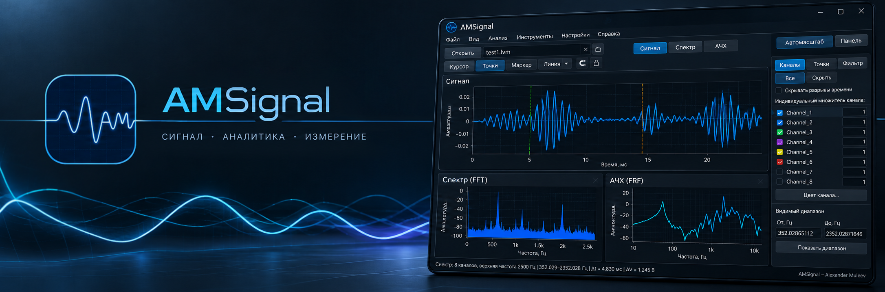

# AMSignal

  

<strong>A portable Windows application for measurement recordings.</strong> 
Signals, FFT, FRF and measurement annotations — from source data to a graph for your report.

  <a href="https://github.com/almuleev/AMSignal/releases/latest"><strong>Download for Windows</strong></a> ·
  <a href="docs/QUICK_START_EN.md">Quick start</a> ·
  <a href="docs/FEATURES_EN.md">Features</a> ·
  <a href="docs/README.md">Documentation</a> ·
  <a href="README_RU.md">Русский</a>

  
  
  

## What makes AMSignal useful

- **Consistent response analysis.** Compare several responses against a shared reference over the same recording interval. Multiple reference channels can be averaged before estimation.
- **A complete measurement workflow.** Load a recording → process channels → analyse → add measurement annotations → export a graph for a report.
- **A workspace you can move.** Take the application, local settings and projects containing source samples to another Windows PC.

## Three analysis modes

| Signal | Spectrum · FFT | Frequency response · FRF |
| --- | --- | --- |
|  |  |  |
| Time signals, zooming and original sample inspection. | Frequency content and channel spectrum comparisons. | Response transfer functions and a separate shared-reference spectrum. |

Click an image to open it at full size. In the FRF example, **Reference A / Reference B** are averaged before H1/Welch; **Response A / Response B** have separate curves calculated over the same recording interval.

The scenes show a local working build's native interface with a [synthetic recording](examples/README.md). [Gallery and explanations](docs/GALLERY_EN.md) · [Image provenance](docs/assets/screenshots/README.md).

## Measurements and report figures

Place points on samples, measure coordinates and intervals, mark events and add vertical or horizontal guide lines. Annotations are saved in projects and included in PNG export.

## More features

- Digital filters, individual multipliers and a global channel formula.
- FFT/FRF interval selection, channel names, colours and visibility.
- Curve symbols for grayscale, light/dark themes and configurable shortcuts.
- Large recordings: automatic RAM or disk-backed operation, with calculations using source samples.

[All features with images and examples →](docs/FEATURES_EN.md)

## Performance in practice

Example GUI measurements for **v0.17.3**: a real **1.024 GB recording**, 6,832,000 samples × 8 channels, Auto with data resident in RAM.

| Operation | Time |
| --- | ---: |
| Open the recording | 33.22 s |
| Full raw FFT, one channel | 2.63 s |
| First H1, seven responses | 1.82 s |
| Repeat H1 with reused input preparation | 0.97 s |

Medians of three processes: Windows 10, Ryzen 5 5600X, 32 GiB RAM; OS cache was not cleared. H1: one reference, L=2048, Hann, 50% overlap, mean removal. Results describe that version; time depends on input, processing and resources. Disk-backed work can be substantially slower. [Method and memory costs →](docs/PERFORMANCE_EN.md)

## Get started

1. Download the GUI EXE from the [latest release](https://github.com/almuleev/AMSignal/releases/latest) and run it from a writable folder.
2. Open a LabVIEW `.lvm`, tabular `.txt` / `.csv`, or the [demonstration recording](examples/README.md).
3. Analyse your data, save an `.AMSig` project to resume work, and export a PNG for your report.

No installer, LabVIEW or Qt is required. To move your workspace, copy the EXE, its adjacent `AMS.ini` and your projects. Starting with v0.17.8-cpu.2, projects save FRF roles, method and L; older projects need CSV or experiment notes. [Quick start](docs/QUICK_START_EN.md) · [Moving your workspace](docs/PORTABLE_EN.md).

GitHub's **Source code** archives contain sources; the CLI can be [built separately](docs/BUILD_EN.md).

## Documentation and project

- [User manual](docs/manual/AMSignal_User_Manual_EN.md) · [Analysis assumptions and limitations](docs/ANALYSIS_EN.md).
- [Documentation index](docs/README.md) · [Build and CLI](docs/BUILD_EN.md) · [Architecture — Russian](docs/ARCHITECTURE.md).
- [Releases](https://github.com/almuleev/AMSignal/releases) · [Changelog](CHANGELOG.md).
- [Report a bug](https://github.com/almuleev/AMSignal/issues) · [Contributing](CONTRIBUTING.md) · [Security](.github/SECURITY.md).

[GNU GPLv3](LICENSE): use, study, modify and redistribute under the license terms.
