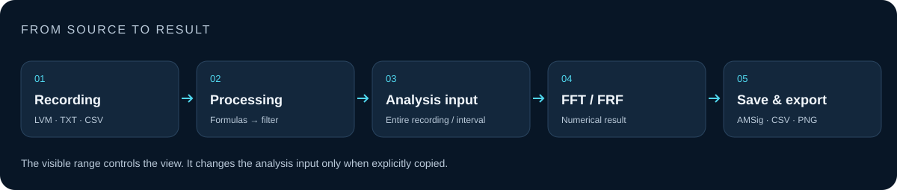

# Analysis and limitations

[Documentation](README.md) · [Русский](ANALYSIS_RU.md)

## The analysis interval is independent of zoom

FFT and FRF share one time interval. With no explicit selection they use the entire recording. **Analysis → Interval** sets bounds; **Use visible interval** copies the Signal view once. Subsequent zooming does not change those bounds. **Entire recording** clears the selection.

The **Visible range** controls at the bottom of **Channels** change the view only: seconds in Signal, hertz in Spectrum and FRF. Confirm with Enter or **Show range**. They are not shown in the Points or Filter tab.

## FFT

FFT removes the channel mean and shows a one-sided linear amplitude spectrum. The frequency spacing is `Fs/N`. Longer intervals improve grid spacing but may mix different operating states.

Rounded or uneven timestamps are prepared on an evenly spaced, gap-free grid with the same sample count. Gaps above 1.5 estimated sample steps are compressed to one step; available samples on both sides remain in the calculation. Linear interpolation can attenuate high frequencies. Missing channel values (`NaN`) are replaced by the channel mean without shifting other channels.

Cadence is estimated from the interval distribution. A separated cluster of short intervals can determine the nominal step even when long outages dominate. Timestamps alone cannot always distinguish missing samples from a real sample-rate change. Uniformly long steps need external cadence information to recover an earlier rate.

The time-domain source remains unchanged. Preparation warnings are recorded in the status and spectrum export metadata. Prefer uniformly sampled continuous data for precise analysis.

## FRF

Select non-empty, non-overlapping Reference and Response roles from the same recording. Visibility does not assign a role. Processing is applied to individual channels before multiple References are averaged sample by sample. Every Response is compared with that mean Reference; this is not a MIMO estimator.

| Method | Input and estimate |
| --- | --- |
| H1 Welch | Periodic Hann window, segment length `L`, hop `L/2`, `H1 = sum(conj(X)Y) / sum(abs(X)^2)` |
| Direct | One segment using all selected samples; complex `Y/X` in valid bins |

For H1, `L = 0` chooses Auto; manual `L` must be even, at least 4 and no greater than the selected sample count. The incomplete Welch tail is not zero-padded. When enabled, mean removal is performed per segment. Frequency spacing is `Fs/L` for H1 and `Fs/N` for Direct.

FRF estimates `Fs` from a typical positive time step and treats the samples as a consecutive sequence. Unlike FFT preparation, it does not interpolate, insert or delete samples at time gaps. Welch segments can cross gaps and LVM section boundaries. The resulting warning requires a physical assessment of the recording; choose a continuous interval when possible. Non-finite input is rejected.

The displayed dynamic coefficient is `KD = abs(H)`, not decibels. Its units are Response units divided by Reference units. The mean-reference spectrum has a separate amplitude scale. DC and weak-reference bins are excluded; a true zero Response remains a valid zero transfer.

Coherence has its own validity flag. It is unavailable for Direct, fewer than two Welch segments, zero output power or invalid bins. It diagnoses linear consistency; it does not automatically filter or correct KD. Display smoothing and frequency-axis changes do not change complex transfer or exported CSV.

The app does not plot FRF phase or implement H2/MIMO. FRF CSV exports complex transfer and diagnostics but cannot be reopened as an FRF document.

## Processing, viewing and export

Channel formulas precede causal filtering. Processing an interval can require filter warm-up from the beginning of the source, so distant intervals can be slower. Cached processed columns and filter continuations help when resources permit.

Curve smoothing, black-and-white symbols, axis labels and visual gap stitching are presentation settings. Stitching does not recover missing measurements and preserves original timestamps in measurements and exports.

`.AMSig` stores raw samples and restorable settings. Processed-channel export applies formulas and filtering; original-channel export does not. CSV/TXT with a `Frequency` column opens as a stored spectrum and cannot reconstruct the time signal.

## RAM, disk and the tested scope

The app automatically chooses full RAM storage or a complete disk overview; there is no separate Light Mode. The min/max overview is for drawing, while exact Snap and analysis use source samples.

The data-and-analysis admission budget is Auto or manual **64–65536 MiB**, constrained by available RAM/commit and system headroom. It is not a process-wide memory cap. Process RAM/private commit, the recording cache quota and temporary analysis workspaces are distinct quantities.

Disk-backed FFT preserves the selected sample count and frequency grid; it needs free disk space and can be substantially slower. RAM pressure does not justify silently reducing `N`, `L` or channel count. Resource or I/O failures can prevent a calculation.

The current test scope is recordings up to **10,000,000,000 bytes inclusive**. This is neither a hard file-opening limit nor a promise that every analysis will complete on every machine. Historical larger-file measurements remain version-specific history; this documentation update introduces no new large-file benchmark claim.

## Reproducible results

Keep the source recording and `.AMSig` project, application version, interval, channel roles and units, formulas, filter settings, method, `N`/`L`, segment count, gaps and preparation warnings. Export CSV for numerical results and PNG for the figure. Evaluate peaks, coherence and reference excitation together rather than drawing conclusions from a smoothed curve alone.
