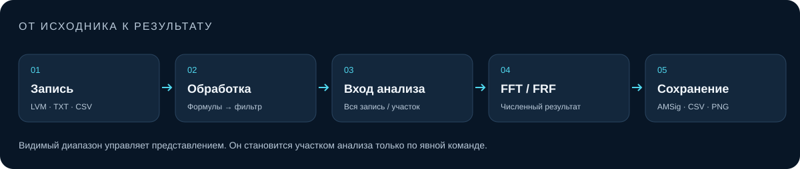

# Анализ и ограничения

[Документация](README_RU.md) · [English](ANALYSIS_EN.md)

## Участок анализа не зависит от масштаба

FFT и FRF используют общий временной участок. Без явного выделения они анализируют всю запись. **Анализ → Участок** задаёт границы, **Взять видимый участок** однократно копирует временной вид. Последующий масштаб не меняет эти границы. **Вся запись** снимает выделение.

Поля **Видимый диапазон** внизу вкладки **Каналы** управляют только представлением: секунды в сигнале, герцы в спектре и FRF. Подтверждение — Enter или **Показать диапазон**. На вкладках «Точки» и «Фильтр» эти поля не показываются.

## FFT

FFT удаляет среднее значение канала и показывает односторонний линейный амплитудный спектр. Частотный шаг равен `Fs/N`. Длинный участок улучшает шаг сетки, но может смешивать разные режимы работы.

Округлённые или неравномерные метки подготавливаются на равномерной сетке без больших разрывов с тем же количеством отсчётов. Разрыв больше 1,5 оценённого шага сжимается до одного шага; доступные отсчёты по обе стороны сохраняются. Линейная интерполяция может ослаблять высокие частоты. Пустые значения канала (`NaN`) заменяются его средним без сдвига остальных каналов.

Шаг оценивается по распределению интервалов. Отделённая группа коротких интервалов может задавать типичный шаг даже при преобладании длинных пауз. По временным меткам не всегда можно отличить пропуски от реальной смены частоты записи. При одинаково длинных шагах для восстановления прежней частоты нужна внешняя информация.

Временные исходные данные не меняются. Предупреждения подготовки записываются в статус и метаданные экспорта спектра. Для точного анализа предпочтительна непрерывная равномерная запись.

## FRF

Назначьте непустые непересекающиеся опоры и отклики одного источника. Видимость не назначает роль. Обработка применяется к отдельным каналам до поотсчётного усреднения нескольких опор. Каждый отклик сравнивается с этой средней опорой; это не MIMO-оценка.

| Метод | Вход и оценка |
| --- | --- |
| H1 Welch | Периодическое окно Hann, длина сегмента `L`, шаг `L/2`, `H1 = sum(conj(X)Y) / sum(abs(X)^2)` |
| Direct | Один сегмент по всем выбранным отсчётам; комплексное `Y/X` в допустимых бинах |

Для H1 `L = 0` включает Auto; ручное `L` должно быть чётным, не меньше 4 и не больше числа отсчётов участка. Неполный хвост Welch нулями не дополняется. Если вычитание среднего включено, оно выполняется по сегментам. Частотный шаг — `Fs/L` для H1 и `Fs/N` для Direct.

FRF оценивает `Fs` по типичному положительному шагу и рассматривает отсчёты как последовательность. В отличие от подготовки FFT, при разрывах он не интерполирует, не вставляет и не удаляет отсчёты. Сегменты Welch могут пересекать разрывы и границы секций LVM. Предупреждение требует оценки физического смысла записи; по возможности выбирайте непрерывный участок. Неконечный вход отклоняется.

Отображаемый коэффициент динамичности — `КД = abs(H)`, не децибелы. Его единицы — единицы отклика, делённые на единицы опоры. Спектр средней опоры имеет отдельную амплитудную шкалу. DC и бины со слабой опорой исключаются; истинный нулевой отклик остаётся допустимым нулём передаточной функции.

Coherence имеет отдельный признак допустимости. Она недоступна для Direct, менее двух сегментов Welch, нулевой мощности отклика или недопустимых бинов. Она диагностирует линейную согласованность, но не фильтрует и не корректирует КД автоматически. Сглаживание отображения и смена частотной оси не меняют комплексный результат и CSV.

Программа не отображает фазу FRF и не реализует H2/MIMO. CSV FRF содержит комплексную передаточную функцию и диагностику, но не открывается как документ FRF.

## Обработка, отображение и экспорт

Формулы каналов выполняются до причинной фильтрации. Для обработки участка может потребоваться прогрев фильтра от начала источника, поэтому дальние участки могут работать медленнее. При достаточных ресурсах помогают кэш обработанных каналов и продолжения фильтра.

Сглаживание кривых, чёрно-белые фигуры, подписи осей и визуальная склейка разрывов — параметры представления. Склейка не восстанавливает пропущенные измерения и сохраняет исходное время в измерениях и экспорте.

`.AMSig` хранит исходные отсчёты и восстанавливаемые настройки. Экспорт обработанных каналов применяет формулы и фильтр, исходных — не применяет. CSV/TXT со столбцом `Frequency` открывается как готовый спектр и не восстанавливает временной сигнал.

## RAM, диск и область испытаний

Программа автоматически выбирает полное хранение в RAM или полный дисковый обзор; отдельного Light Mode нет. Обзор min/max служит отрисовке, точный Snap и анализ используют исходные отсчёты.

Бюджет допуска данных и расчётов выбирается автоматически либо вручную в пределах **64–65536 MiB**, с учётом доступных RAM/commit и системного резерва. Он не ограничивает всю память процесса. RAM процесса/private commit, квота кэша записей и временные рабочие файлы анализа — разные величины.

Дисковый FFT сохраняет число отсчётов и частотную сетку; ему нужны свободное место и время, иногда существенно большее. Нехватка RAM не является основанием незаметно уменьшать `N`, `L` или число каналов. Ошибки ресурсов или ввода-вывода могут не позволить завершить расчёт.

Текущая область испытаний — записи до **10 000 000 000 байт включительно**. Это не жёсткий предел открытия и не обещание завершения любого анализа на любом компьютере. Старые замеры более крупных файлов остаются историей конкретных версий; это обновление документации не добавляет новых заявлений о больших замерах.

## Воспроизводимость результатов

Сохраняйте исходную запись и проект `.AMSig`, версию программы, участок, роли и единицы каналов, формулы, фильтр, метод, `N`/`L`, число сегментов, разрывы и предупреждения подготовки. Для численного результата экспортируйте CSV, для рисунка — PNG. Оценивайте пики, coherence и уровень опорного возбуждения совместно, не делая выводов только по сглаженной кривой.
