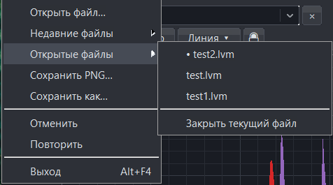

# AMSignal features

[Project](../README.md) · [Documentation](README.md) · [Русский](FEATURES_RU.md)

From a recording to a finished graph: inspect signals, select an interval, process channels, calculate FFT and FRF, add measurement annotations and save the result.

The main graph images below use AMSignal's native interface code with the [synthetic example containing two references and two responses](../examples/README.md). The application calculates the curves; mouse pointers are excluded from rendering. The multiple-recording section also uses a user-provided screenshot of the application's menu. [Build and image provenance](assets/screenshots/README.md).

## FFT: find the frequency components

Switch from the time signal to its amplitude spectrum to compare channels, inspect excitation tones and examine peaks.

**Try it:** open the demo, show all four channels, select **Analysis → Entire recording**, then **Spectrum** (`F`). Wait for calculation and set the visible frequency range to **0–210 Hz** in **Channels**. The scene uses 32,768 samples at 1024 Hz, with broadband excitation and 12 tones.

FFT uses the chosen analysis interval and active channel processing. Frequency zoom changes the view, not the calculation input. Enable Snap (`G`) and place points on spectrum bins to compare peak frequencies and amplitudes. A spectral peak alone does not establish a resonance; compare it with the excitation and [FRF analysis](ANALYSIS_EN.md).

## FRF with multiple references and responses

Assign `Reference A` and `Reference B` as references, and `Response A` and `Response B` as responses. The application processes channels first, averages the reference samples and calculates a separate transfer function for each response against that shared reference over the same recording interval.

The upper graph shows the dynamic coefficient `KD = |H|`: green is Response A, red is Response B. The lower graph shows the amplitude spectrum of the mean reference in volts on a separate scale. The panel displays both roles and H1/Welch parameters: `L=2048`, 31 segments, 50% overlap and 0.5 Hz spacing.

**Try it:** open the example → **FRF** (`R`) → select both references and both responses → H1/Welch, `L=2048` → wait for calculation. Frequency view: 5–210 Hz, smoothing off. This is an averaged shared reference, not independent multiple-input MIMO identification. [Analysis method](ANALYSIS_EN.md).

## Points, markers and guide lines

Points compare coordinates and intervals; markers identify events; vertical and horizontal guide lines indicate positions in time and amplitude.

The example has three points on Response B samples, a “Minimum B” marker, a vertical line at `t=1.10 s` and a horizontal line at `U=0.5 V`. Time differences appear between points. The Points panel controls labels, colour, name and visibility of the group.

- **Points:** enable **Points** (`P`) and click the curve. The magnet button (`G`) snaps to original samples.
- **Marker:** choose **Marker** (`M`), then select an event.
- **Lines:** choose a vertical or horizontal line from **Line**; the default shortcuts are `V` and `H`.
- **Exact coordinate:** `Shift+L` opens guide-line input. Lock (`L`) protects finished annotations; `Ctrl+Z` undoes an action.

Set up processing before final annotations: changing a formula or filter can clear related objects.

## Analysis interval

Choose one interval for consistent FFT and FRF calculations. The interval is independent of the viewing zoom.

The scene selects **1.15–1.35 s** inside a 1–1.5 s view. Handles mark the boundaries; excluded areas are hatched.

Open **Analysis → Interval…** (`Ctrl+I`) and enter the limits. **Use visible interval** (`Ctrl+Shift+I`) copies the current view limits once; later zooming does not move them. **Entire recording** (`Ctrl+Alt+I`) clears the selection. Visible interval boundaries can be dragged.

## Digital filter

The **Filter** panel (`Ctrl+3`) controls channel frequency processing. Modes include low-pass, high-pass, band-pass and band-stop; families include Butterworth, Bessel, Chebyshev and Linkwitz–Riley.

The scene enables a **45 Hz Butterworth low-pass**. Select a mode and family, adjust cutoff sliders and enable **Signal filter**. Slider changes apply when released. Cutoffs must respect the recording's Nyquist frequency.

Source samples are retained. Signal and FFT use active processing; FRF has a separate **Apply channel processing** switch. The filter has a finite roll-off and causal delay; it does not instantly zero the spectrum beyond a cutoff.

## Names, multipliers and global formula

The **Channels** tab (`Ctrl+1`) groups names, colours, visibility, individual multipliers and the global formula.

### Rename a channel

Double-click a channel name, enter a new label and press `Enter`; `Esc` cancels editing. Response A is renamed **Sensor A** in the scene. The new name appears in the list and legend.

### Set an individual multiplier

Enter a numeric coefficient beside a channel and press `Enter`. The scene uses **2** for Sensor A and **1** for the other channels. This is a numeric field; arbitrary expressions for all channels have their own field.

### Apply a formula to all channels

Enter an expression in **Global formula for all channels** and choose **Apply to all channels** or press `Enter`. The scene uses `(x-0.02)*1.5` to remove an offset and scale the signal. Sensor A's subsequent multiplier of 2 gives `2*((x-0.02)*1.5)`.

Processing order: **global formula → individual channel processing → digital filter**. Check physical units and function domains. See the [manual](manual/AMSignal_User_Manual_EN.md) for supported expressions and processing rules.

## Curve symbols for grayscale printing

Enable **View → Curve symbols for grayscale**. Channels receive distinct symbols so readers can identify them without relying on colour.

The scene shows two responses over 1–1.12 s: triangles and diamonds remain distinct when printed in grayscale. Coloured curves remain coloured; the option adds identifying symbols while keeping solid lines. Press `D` to switch theme.

## PNG for a report

Press `Ctrl+Alt+S` and choose where to save the PNG. Export includes the graph with current curves, range, labels and measurement annotations, without control panels.

This is an actual PNG saved by AMSignal's export function for the measurement example above. For a print version, enable the light theme and curve symbols first: [PNG with curve symbols](assets/screenshots/print-export-en.png).

To resume editing, save an `.AMSig` project separately (`Ctrl+S`). PNG is a finished figure; a project retains source samples and restorable settings.

## Save a project and continue later

An `.AMSig` project retains original samples, channel names and visibility, processing, annotations, the analysis interval and supported graph settings. You can reopen its saved samples without the original recording file.

**Try it:** rename a channel, apply a filter, add measurement points and save with `Ctrl+S`. Close the document, reopen the `.AMSig` and continue editing. An asterisk in the title indicates unsaved changes.

FRF roles, method and segment length `L` are not serialized in a project. Keep them in experiment notes and save the calculated FRF as CSV. A project, a numerical result and a PNG serve different purposes.

## Export numerical data

Use **Save as** (`Ctrl+Shift+S`) to choose the export purpose, applicable format, range and channels.

| What you need | Export |
| --- | --- |
| Source measurements without processing | Original channels; CSV, TXT or LVM in Signal mode |
| Results after formulas and filtering | Processed channels; CSV, TXT or LVM in Signal mode |
| Frequency and amplitude values | Spectrum; CSV or TXT |
| Calculated transfer functions | FRF CSV with frequency, KD, real/imaginary H, validity, coherence and reference-spectrum information |

**Example:** after filtering a recording, export the processed channels over the required time range, then save a PNG of the annotated graph for the same report. Choose original-channel export when you need the unprocessed measurements instead.

A CSV/TXT with a `Frequency` column can reopen as a stored spectrum, without time samples for a new FFT or FRF calculation. FRF CSV is a saved result and cannot reopen as an FRF document. See [projects and export](manual/AMSignal_User_Manual_EN.md).

## Several recordings in one session

Open or drag several files into the application. They load sequentially as separate documents. Switch using the top file selector or **File → Open files**; the adjacent `×` closes the active document.

The screenshot shows `test2.lvm`, `test.lvm` and `test1.lvm` open together. A dot beside `test2.lvm` marks the active document. Choose another name to switch; **Close current file** is at the bottom. This user-provided screenshot shows the Russian interface: **Открытые файлы** means **Open files**, and **Закрыть текущий файл** means **Close current file**.

Each document keeps its own data, measurement annotations, analysis interval, FRF roles and undo history while open. **Example:** open a baseline recording and a recording after an adjustment, then switch between them to inspect corresponding events. Documents are separate workspaces; save each required project before closing the session.

## Inspect gaps in a recording

Gap markers identify interruptions in acquisition. Click a marker to inspect its duration and the estimated number of missing samples. **Stitch gaps** (`Shift+G`) compresses gaps visually so neighbouring recorded sections are easier to inspect.

**Example:** on a recording containing a pause, inspect the gap card, toggle stitching and compare the view. Measurements and exports retain original timestamps; stitching does not reconstruct missing samples.

The demonstration recording used in these images has no acquisition gaps. Try this feature on a recording with a known interruption. For FFT and FRF, select a continuous interval where possible and read the [gap-handling rules](ANALYSIS_EN.md).

## Move your working environment

AMSignal runs as a standalone Windows EXE without an installer or an installed LabVIEW or Qt. Local preferences are stored in `AMS.ini` beside the application.

**Example:** save your projects, close the app, then copy the **EXE + `AMS.ini` + `.AMSig` projects** to a writable folder on another Windows x64 computer. Open the copied projects and check units, processing and the analysis interval. Keep FRF CSV and experiment notes alongside them when needed.

Caches and recent-file paths are separate from project data; caches can be regenerated and old recent-file paths may need replacing. See [the portable-workspace guide](PORTABLE_EN.md).

## Playback for following events

In **Signal**, press `Space` to start or pause the moving playhead. **View** provides playback and speed controls. Playback follows the recording visually and does not change samples or analysis parameters.

**Try it:** open the demo in Signal, start playback, pause near an event and place a measurement marker. Change playback speed to inspect the sequence at a comfortable pace. This is visual playback, not audio output.

## Undo, redo and protect annotations

Use `Ctrl+Z` to undo and `Ctrl+Shift+Z` to redo. History belongs to each document; a completed drag or filter-slider release is one history action. `Esc` cancels an unfinished gesture or tool, while annotation lock (`L`) protects finished objects from accidental editing.

**Try it:** move a measurement point, undo the move, redo it, then enable the lock. Undo history is bounded and is not a substitute for saving a project.

## Adapt the workspace

- **Shortcuts:** **Help → Keyboard shortcuts** shows current assignments. Change, clear or reset them and resolve conflicts; the keys shown on this page are defaults.
- **Theme and language:** choose English/Russian and light/dark presentation; `D` switches theme. These choices do not change numerical results.
- **Axis labels:** set names and physical units in **Settings → General settings** before exporting a figure. Labels describe data; changing a label does not convert values.

**Example:** label the measured quantity and units, choose a light theme with curve symbols, and save a PNG ready for your report.

[Quick start](QUICK_START_EN.md) · [Full manual](manual/AMSignal_User_Manual_EN.md) · [Gallery](GALLERY_EN.md)
