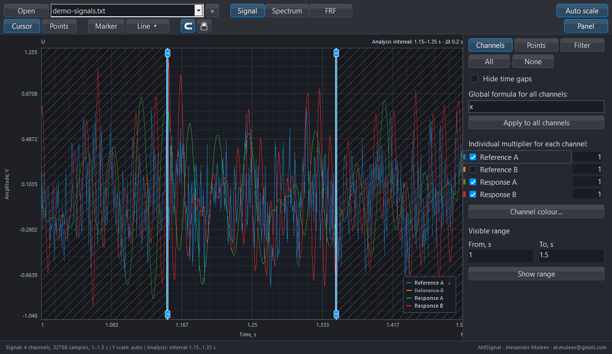
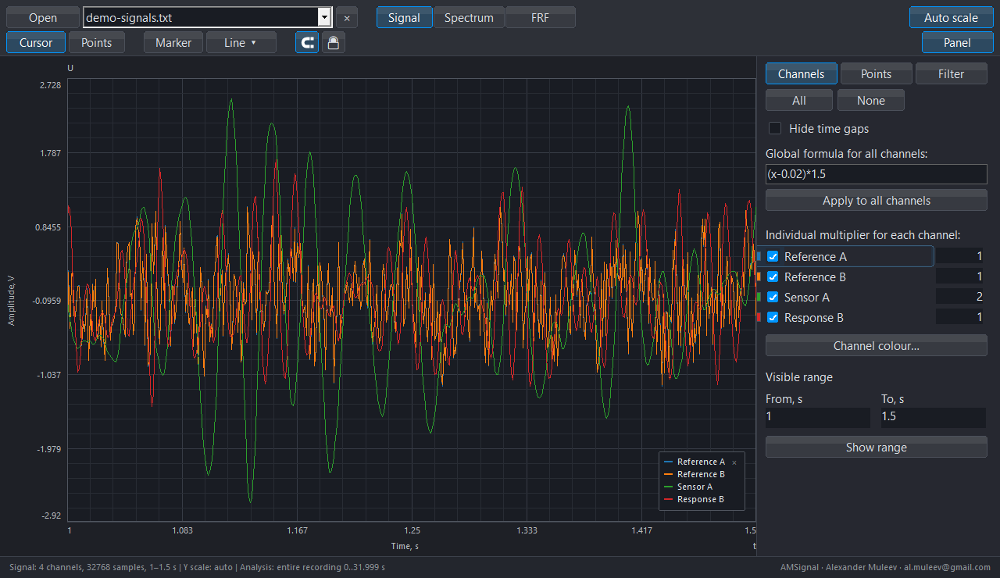
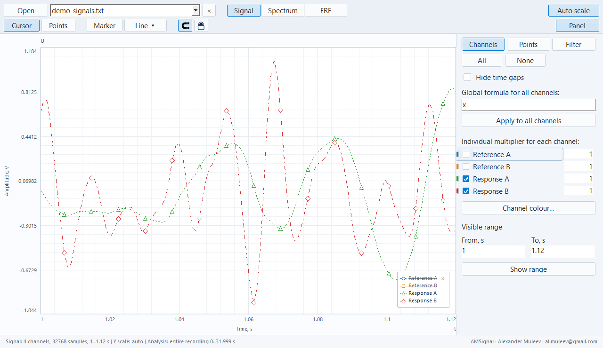
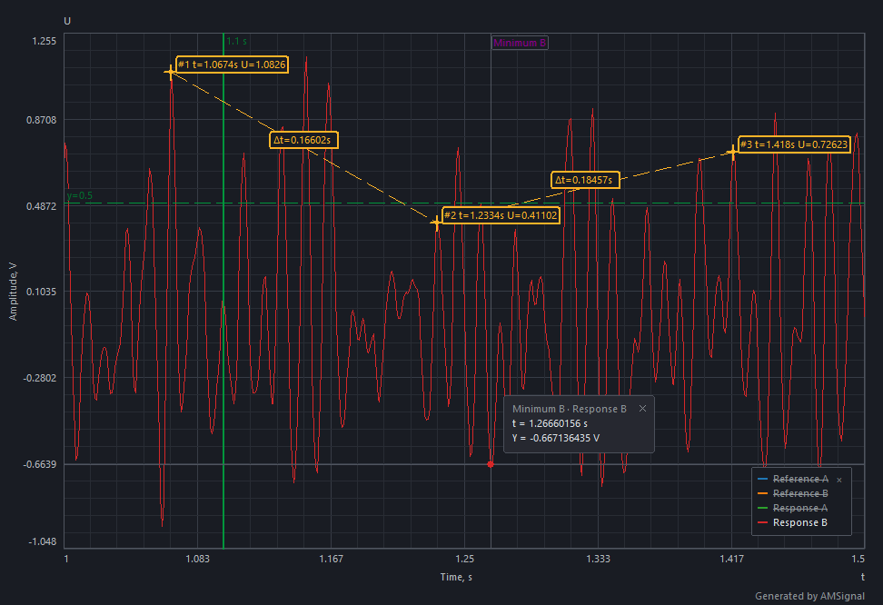

# AMSignal features

[Project](../README.md) · [Documentation](README.md) · [Русский](FEATURES_RU.md)

From a recording to a finished graph: inspect signals, select an interval, process channels, calculate FFT and FRF, add measurement annotations and save the result.

The images below use AMSignal's native interface code with the [synthetic example containing two references and two responses](../examples/README.md). The application calculates the curves; mouse pointers are excluded from rendering. [Build and image provenance](assets/screenshots/README.md).

## FRF with multiple references and responses

Assign `Reference A` and `Reference B` as references, and `Response A` and `Response B` as responses. The application processes channels first, averages the reference samples and calculates a separate transfer function for each response against that shared reference over the same recording interval.

The upper graph shows the dynamic coefficient `KD = |H|`: green is Response A, red is Response B. The lower graph shows the amplitude spectrum of the mean reference in volts on a separate scale. The panel displays both roles and H1/Welch parameters: `L=2048`, 31 segments, 50% overlap and 0.5 Hz spacing.

**Try it:** open the example → **FRF** (`R`) → select both references and both responses → H1/Welch, `L=2048` → wait for calculation. Frequency view: 5–210 Hz, smoothing off. This is an averaged shared reference, not independent multiple-input MIMO identification. [Analysis method](ANALYSIS_EN.md).

## Points, markers and guide lines

Points compare coordinates and intervals; markers identify events; vertical and horizontal guide lines indicate positions in time and amplitude.

The example has three points on Response B samples, a “Minimum B” marker, a vertical line at `t=1.10 s` and a horizontal line at `U=0.5 V`. Time differences appear between points. The Points panel controls labels, colour, name and visibility of the group.

- **Points:** enable **Points** (`P`) and click the curve. The magnet button (`G`) snaps to original samples.
- **Marker:** choose **Marker** (`M`), then select an event.
- **Lines:** choose a vertical or horizontal line from **Line**; the default shortcuts are `V` and `H`.
- **Exact coordinate:** `Shift+L` opens guide-line input. Lock (`L`) protects finished annotations; `Ctrl+Z` undoes an action.

Set up processing before final annotations: changing a formula or filter can clear related objects.

## Analysis interval

Choose one interval for consistent FFT and FRF calculations. The interval is independent of the viewing zoom.

The scene selects **1.15–1.35 s** inside a 1–1.5 s view. Handles mark the boundaries; excluded areas are hatched.

Open **Analysis → Interval…** (`Ctrl+I`) and enter the limits. **Use visible interval** (`Ctrl+Shift+I`) copies the current view limits once; later zooming does not move them. **Entire recording** (`Ctrl+Alt+I`) clears the selection. Visible interval boundaries can be dragged.

## Digital filter

The **Filter** panel (`Ctrl+3`) controls channel frequency processing. Modes include low-pass, high-pass, band-pass and band-stop; families include Butterworth, Bessel, Chebyshev and Linkwitz–Riley.

The scene enables a **45 Hz Butterworth low-pass**. Select a mode and family, adjust cutoff sliders and enable **Signal filter**. Slider changes apply when released. Cutoffs must respect the recording's Nyquist frequency.

Source samples are retained. Signal and FFT use active processing; FRF has a separate **Apply channel processing** switch. The filter has a finite roll-off and causal delay; it does not instantly zero the spectrum beyond a cutoff.

## Names, multipliers and global formula

The **Channels** tab (`Ctrl+1`) groups names, colours, visibility, individual multipliers and the global formula.

### Rename a channel

Double-click a channel name, enter a new label and press `Enter`; `Esc` cancels editing. Response A is renamed **Sensor A** in the scene. The new name appears in the list and legend.

### Set an individual multiplier

Enter a numeric coefficient beside a channel and press `Enter`. The scene uses **2** for Sensor A and **1** for the other channels. This is a numeric field; arbitrary expressions for all channels have their own field.

### Apply a formula to all channels

Enter an expression in **Global formula for all channels** and choose **Apply to all channels** or press `Enter`. The scene uses `(x-0.02)*1.5` to remove an offset and scale the signal. Sensor A's subsequent multiplier of 2 gives `2*((x-0.02)*1.5)`.

Processing order: **global formula → individual channel processing → digital filter**. Check physical units and function domains. See the [manual](manual/AMSignal_User_Manual_EN.md) for supported expressions and processing rules.

## Curve symbols for grayscale printing

Enable **View → Curve symbols for grayscale**. Channels receive distinct symbols and line patterns so readers can identify them without relying on colour.

The scene shows two responses over 1–1.12 s: triangles, diamonds and line patterns remain distinct when printed in grayscale. Coloured curves remain coloured; the option adds identifying symbols and line patterns. Press `D` to switch theme.

## PNG for a report

Press `Ctrl+Alt+S` and choose where to save the PNG. Export includes the graph with current curves, range, labels and measurement annotations, without control panels.

This is an actual PNG saved by AMSignal's export function for the measurement example above. For a print version, enable the light theme and curve symbols first: [PNG with curve symbols](assets/screenshots/print-export-en.png).

To resume editing, save an `.AMSig` project separately (`Ctrl+S`). PNG is a finished figure; a project retains source samples and restorable settings.

[Quick start](QUICK_START_EN.md) · [Full manual](manual/AMSignal_User_Manual_EN.md) · [Gallery](GALLERY_EN.md)
