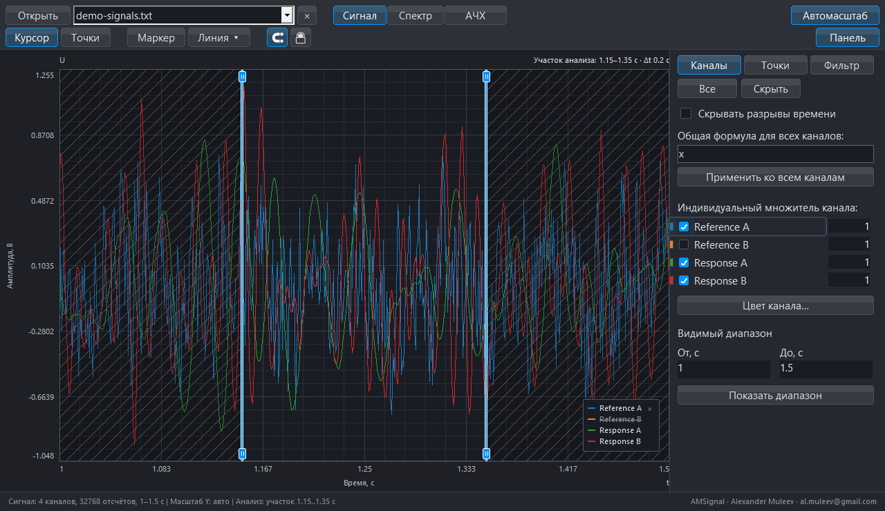
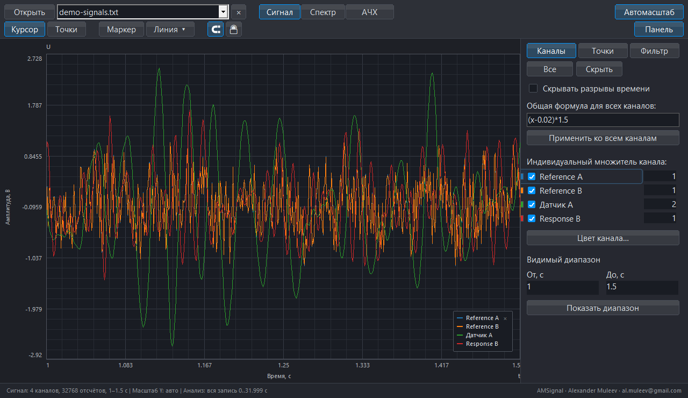
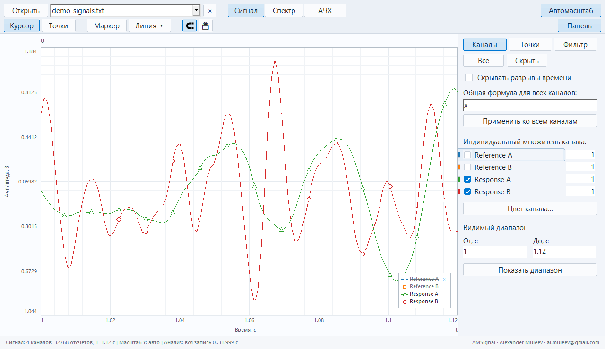
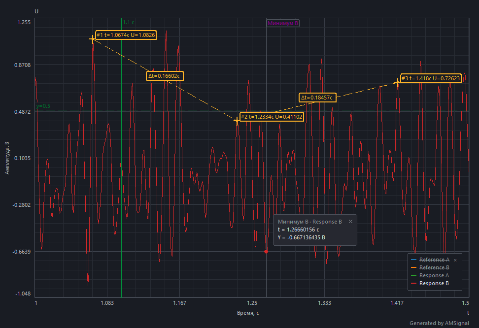

# Возможности AMSignal

[Проект](../README_RU.md) · [Документация](README_RU.md) · [English](FEATURES_EN.md)

От записи измерений к готовому графику: просматривайте сигнал, выбирайте участок, обрабатывайте каналы, рассчитывайте FFT и АЧХ, добавляйте разметку и сохраняйте результат.

Основные графики ниже получены нативным кодом интерфейса AMSignal на [синтетическом примере с двумя опорами и двумя откликами](../examples/README_RU.md). Кривые рассчитаны программой; указатель мыши в изображения не включён. Раздел нескольких записей дополнен предоставленным пользователем скриншотом меню приложения. [Версия и происхождение кадров](assets/screenshots/README.md).

## FFT: частотный состав сигнала

Переключайтесь от временного сигнала к амплитудному спектру, чтобы сравнивать каналы, видеть частоты возбуждения и исследовать пики.

**Как повторить:** откройте пример, включите четыре канала, выберите **Анализ → Вся запись**, затем **Спектр** (`F`). Дождитесь расчёта и задайте видимый частотный диапазон **0–210 Гц** в «Каналах». На кадре использованы 32 768 отсчётов при 1024 Гц, широкополосное возбуждение и 12 тонов.

FFT использует выбранный участок анализа и активную обработку каналов. Частотный zoom меняет вид, а не вход расчёта. Включите привязку (`G`) и ставьте точки на спектральные отсчёты для сравнения частот и амплитуд пиков. Один пик спектра ещё не доказывает резонанс: сопоставляйте его с возбуждением и [анализом АЧХ](ANALYSIS_RU.md).

## АЧХ с несколькими опорами и откликами

Назначьте `Reference A` и `Reference B` опорами, `Response A` и `Response B` — откликами. Программа сначала обрабатывает каналы, затем усредняет опорные отсчёты и строит отдельную передаточную функцию каждого отклика относительно общей опоры на одном участке записи.

Верхний график показывает коэффициент динамичности `КД = |H|`: зелёная кривая — Response A, красная — Response B. Нижний график показывает амплитудный спектр средней опоры в вольтах с отдельной шкалой. Справа видны обе роли и параметры H1/Welch: `L=2048`, 31 сегмент, перекрытие 50%, шаг 0,5 Гц.

**Как повторить:** откройте пример → **АЧХ** (`R`) → выберите две опоры и два отклика → H1/Welch, `L=2048` → дождитесь расчёта. Частотный вид — 5–210 Гц, сглаживание выключено. Это усреднённая общая опора, а не независимое многовходовое MIMO-отождествление. [Методика анализа](ANALYSIS_RU.md).

## Точки, маркеры и направляющие

Точки позволяют сравнивать координаты и интервалы; маркеры отмечают важные события; вертикальные и горизонтальные линии задают положения по времени и уровню.

На примере стоят три точки на отсчётах Response B, маркер «Минимум B», вертикальная линия `t=1,10 с` и горизонтальная `U=0,5 В`. Между точками показана разность времени. В панели «Точки» можно менять состав подписей, цвет, имя и видимость группы.

- **Точки:** включите кнопку **Точки** (`P`) и щёлкайте по кривой. Кнопка магнита (`G`) включает привязку к исходным отсчётам.
- **Маркер:** нажмите **Маркер** (`M`), затем укажите событие.
- **Линии:** выберите вертикальную или горизонтальную линию в меню **Линия**; клавиши по умолчанию — `V` и `H`.
- **Точная координата:** `Shift+L` открывает ввод направляющей. Блокировка (`L`) защищает готовую разметку, `Ctrl+Z` отменяет действие.

Обработку лучше настроить до окончательной разметки: изменение формулы или фильтра может сбросить связанные объекты.

## Участок анализа

Выбирайте один интервал для согласованного расчёта FFT и АЧХ. Участок независим от масштаба просмотра.

На кадре выбран интервал **1,15–1,35 с** внутри видимого диапазона 1–1,5 с. Границы отмечены ручками, исключённые области заштрихованы.

Откройте **Анализ → Участок…** (`Ctrl+I`) и задайте границы. **Взять видимый участок** (`Ctrl+Shift+I`) однократно копирует текущие границы просмотра; последующий zoom не сдвигает их. **Вся запись** (`Ctrl+Alt+I`) снимает выбор. Видимые границы участка можно перетаскивать.

## Цифровой фильтр

Панель **Фильтр** (`Ctrl+3`) управляет частотной обработкой каналов. Доступны ФНЧ, ФВЧ, полосовой и режекторный режимы; семейства — Баттерворт, Бессель, Чебышёв и Линквиц–Райли.

На кадре включён **ФНЧ Баттерворта, 45 Гц**. Выберите режим и семейство, установите границы ползунками и включите **Фильтр сигнала**. Изменение ползунка применяется после отпускания. Частоты должны укладываться в частоту Найквиста записи.

Исходные отсчёты сохраняются. Сигнал и FFT используют активную обработку; в АЧХ есть отдельный переключатель **Применять обработку каналов**. Фильтр имеет конечный спад и причинную задержку — это не мгновенное обнуление спектра за границей.

## Имена, множители и общая формула

Вкладка **Каналы** (`Ctrl+1`) объединяет имена, цвета, видимость, индивидуальные множители и общую формулу.

### Переименовать канал

Дважды щёлкните по имени канала, введите своё название и нажмите `Enter`; `Esc` отменяет редактирование. На кадре Response A переименован в **Датчик A**. Название меняется в списке и легенде.

### Задать индивидуальный множитель

Введите числовой коэффициент справа от нужного канала и нажмите `Enter`. На кадре множитель «Датчика A» равен **2**, остальных каналов — **1**. Это поле числа; произвольное выражение для всех каналов вводится отдельно.

### Применить формулу ко всем каналам

Введите выражение в **Общая формула для всех каналов** и нажмите **Применить ко всем каналам** или `Enter`. На кадре применяется `(x-0.02)*1.5`: вычитание смещения и масштабирование. Для «Датчика A» последующий индивидуальный множитель 2 даёт `2*((x-0.02)*1.5)`.

Порядок обработки: **общая формула → индивидуальная обработка канала → цифровой фильтр**. Проверяйте физические единицы и область определения функций. Полный набор выражений и правила обработки — в [руководстве](manual/AMSignal_User_Manual_RU.md).

## Фигуры кривых для чёрно-белой печати

Включите **Вид → Фигуры кривых для Ч/Б**. Каналы получают разные символы, чтобы их можно было различить без опоры на цвет.

На кадре показаны два отклика в диапазоне 1–1,12 с: треугольники и ромбы сохраняют различимость при печати в оттенках серого. Цветные кривые при этом остаются цветными; переключатель добавляет отличительные фигуры, сохраняя сплошные линии. Светлая тема переключается клавишей `D`.

## PNG для отчёта

Нажмите `Ctrl+Alt+S` и выберите место сохранения PNG. Экспортируется график с текущими кривыми, диапазоном, подписями и измерительной разметкой, без панелей управления.

Это настоящий PNG, сохранённый функцией экспорта AMSignal для измерительного примера выше. Для печатного варианта заранее включите светлую тему и фигуры кривых: [пример PNG с фигурами](assets/screenshots/print-export-ru.png).

Для продолжения работы отдельно сохраните проект `.AMSig` (`Ctrl+S`). PNG — готовый рисунок; проект сохраняет исходные отсчёты и восстанавливаемые настройки.

## Сохранить проект и продолжить позже

Проект `.AMSig` сохраняет исходные отсчёты, имена и видимость каналов, обработку, разметку, участок анализа и поддерживаемые настройки графика. Для чтения сохранённых отсчётов исходный файл записи не нужен.

**Как повторить:** переименуйте канал, примените фильтр, поставьте измерительные точки и сохраните проект через `Ctrl+S`. Закройте документ, снова откройте `.AMSig` и продолжите редактирование. Звёздочка в заголовке означает несохранённые изменения.

Роли АЧХ, метод и длина сегмента `L` в проект не записываются. Сохраняйте их в заметках эксперимента, а рассчитанную АЧХ — в CSV. Проект, численный результат и PNG решают разные задачи.

## Экспорт численных данных

Команда **Сохранить как** (`Ctrl+Shift+S`) позволяет выбрать назначение экспорта, доступный формат, диапазон и каналы.

| Что требуется | Экспорт |
| --- | --- |
| Исходные измерения без обработки | Исходные каналы; CSV, TXT или LVM в режиме «Сигнал» |
| Результат применения формул и фильтра | Обработанные каналы; CSV, TXT или LVM в режиме «Сигнал» |
| Частоты и амплитуды | Спектр; CSV или TXT |
| Рассчитанные передаточные функции | CSV АЧХ: частота, КД, действительная/мнимая части H, признаки валидности, когерентность и сведения о спектре опоры |

**Пример:** после фильтрации выгрузите обработанные каналы на нужном временном диапазоне, затем сохраните PNG размеченного графика для того же отчёта. Если нужны измерения без обработки, выберите экспорт исходных каналов.

CSV/TXT со столбцом `Frequency` можно открыть как сохранённый спектр, без временных отсчётов для нового расчёта FFT или АЧХ. CSV АЧХ хранит результат и не открывается как документ АЧХ. Подробнее — [проекты и экспорт](manual/AMSignal_User_Manual_RU.md).

## Несколько записей в одной сессии

Откройте или перетащите в приложение несколько файлов. Они загружаются последовательно как отдельные документы. Переключайтесь верхним списком файлов или через **Файл → Открытые файлы**; соседняя кнопка `×` закрывает активный документ.

На кадре открыты `test2.lvm`, `test.lvm` и `test1.lvm`. Точка рядом с `test2.lvm` отмечает активный документ. Выберите другое имя для переключения; команда **Закрыть текущий файл** находится внизу списка.

У каждого открытого документа свои данные, измерительная разметка, участок анализа, роли АЧХ и история действий. **Пример:** откройте исходную запись и запись после регулировки, затем переключайтесь между ними для просмотра соответствующих событий. Документы — отдельные рабочие области; перед завершением сессии сохраните каждый нужный проект.

## Разрывы записи

Метки разрывов показывают остановки регистрации. Щелчок по метке открывает длительность разрыва и оценку числа пропущенных отсчётов. **Сшивка разрывов** (`Shift+G`) визуально сжимает паузы, чтобы соседние записанные участки было удобнее просматривать.

**Пример:** в записи с паузой откройте карточку разрыва, включите сшивку и сравните вид. Измерения и экспорт сохраняют исходные временные координаты; сшивка не восстанавливает отсутствующие отсчёты.

В демонстрационной записи на этих изображениях разрывов регистрации нет. Проверяйте функцию на записи с известной паузой. Для FFT и АЧХ по возможности выбирайте непрерывный участок и учитывайте [правила обработки разрывов](ANALYSIS_RU.md).

## Переносимое рабочее окружение

AMSignal запускается отдельным Windows EXE без установщика и установленного LabVIEW или Qt. Локальные предпочтения хранятся в `AMS.ini` рядом с приложением.

**Пример:** сохраните проекты, закройте программу и перенесите **EXE + `AMS.ini` + проекты `.AMSig`** в доступную для записи папку на другом компьютере с Windows x64. Откройте скопированные проекты и проверьте единицы, обработку и участок анализа. При необходимости храните рядом CSV АЧХ и заметки эксперимента.

Кэши и пути недавних файлов существуют отдельно от данных проекта: кэши создаются заново, а старые пути могут потребовать замены. Подробнее — [перенос рабочего окружения](PORTABLE_RU.md).

## Воспроизведение для просмотра событий

В режиме **Сигнал** клавиша `Space` запускает или приостанавливает движение указателя воспроизведения. В меню **Вид** доступны управление воспроизведением и скорость. Воспроизведение показывает ход записи, сохраняя отсчёты и параметры анализа.

**Как повторить:** откройте пример в режиме «Сигнал», запустите воспроизведение, остановитесь около события и поставьте измерительный маркер. Подберите скорость для удобного просмотра последовательности. Это визуальное воспроизведение, без вывода звука.

## Отмена, повтор и защита разметки

`Ctrl+Z` отменяет действие, `Ctrl+Shift+Z` повторяет его. У каждого документа своя история; завершённое перетаскивание или отпускание ползунка фильтра считается одним действием. `Esc` отменяет незавершённый жест или инструмент, а блокировка разметки (`L`) защищает готовые объекты от случайного редактирования.

**Как повторить:** переместите измерительную точку, отмените перемещение, повторите его и включите блокировку. История ограничена и не заменяет сохранение проекта.

## Настроить рабочее пространство

- **Горячие клавиши:** **Справка → Горячие клавиши** показывает текущие назначения. Их можно менять, очищать и сбрасывать, устраняя конфликты; на этой странице указаны сочетания по умолчанию.
- **Тема и язык:** доступны русский/английский интерфейс, светлая/тёмная тема; `D` переключает тему. Эти настройки не меняют численные результаты.
- **Подписи осей:** задайте названия величин и физические единицы в **Настройки → Общие настройки** перед экспортом рисунка. Подпись описывает данные; её изменение не пересчитывает значения.

**Пример:** подпишите измеряемую величину и единицы, выберите светлую тему с фигурами кривых и сохраните PNG для отчёта.

[Быстрый старт](QUICK_START_RU.md) · [Полное руководство](manual/AMSignal_User_Manual_RU.md) · [Галерея](GALLERY_RU.md)
