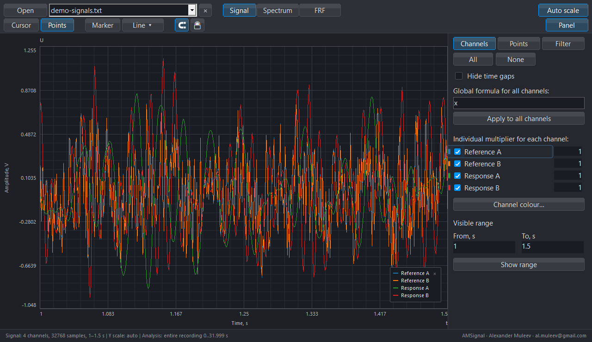
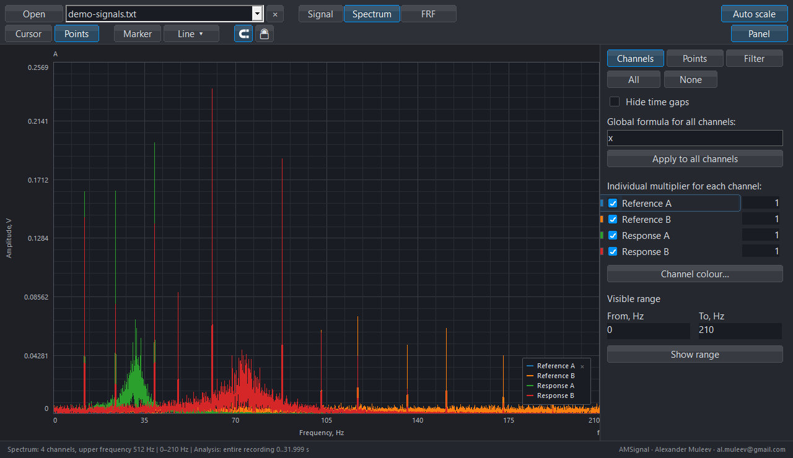
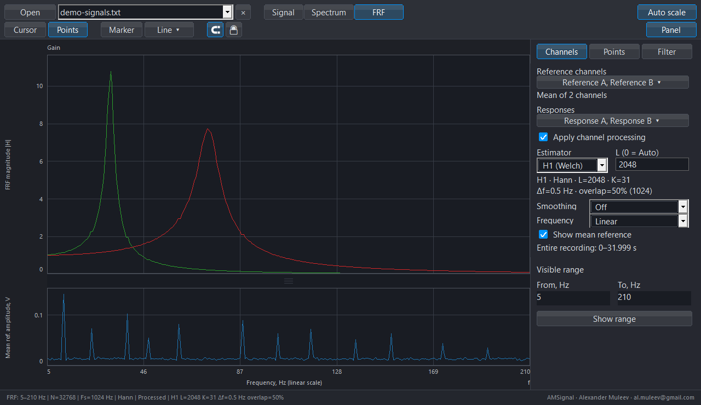
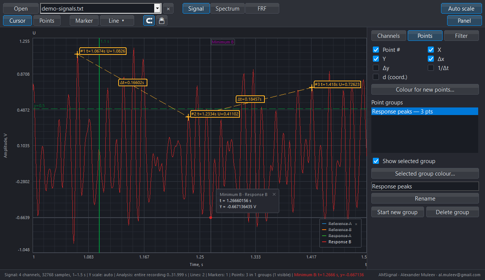
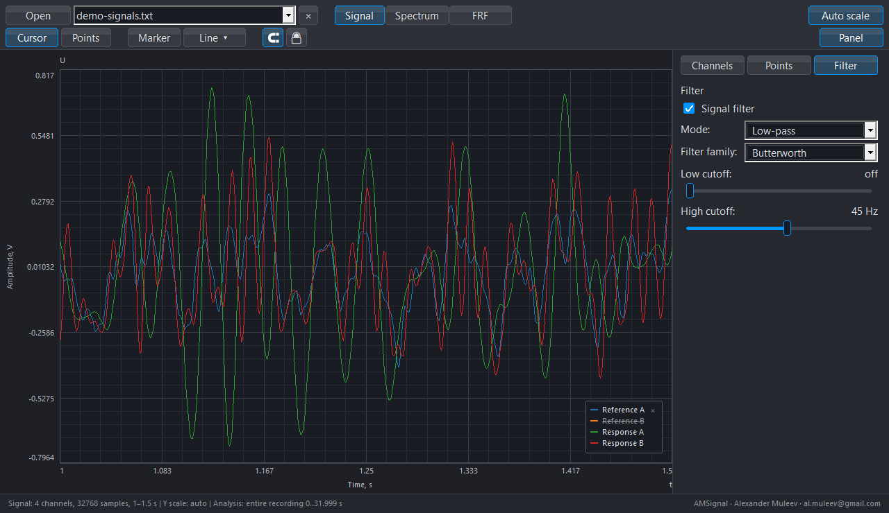
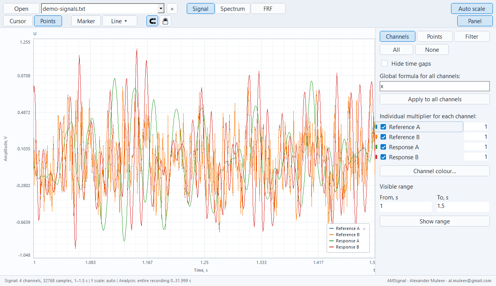

# AMSignal in use

[Documentation](README.md) · [Features](FEATURES_EN.md) · [Русский](GALLERY_RU.md)

The scenes show the local working build's native interface with the [synthetic recording containing two references and two responses](../examples/README.md). They use the application's rendering code, without a cursor or curve retouching. See the [image manifest](assets/screenshots/README.md) for the build, method and hashes.

## Signal

Four channels over 1–1.5 s. Analysis defaults to the entire recording; zoom does not select calculation input.

## Spectrum

FFT of all 32,768 samples at 1024 Hz; view 0–210 Hz. A broadband floor and 12 tones show the excitation's frequency content; the two responses show amplification near resonances.

## FRF with multiple references

Reference A / Reference B are averaged before H1; Response A / Response B have separate calculated curves. The upper graph shows KD; the lower graph shows the mean-reference spectrum. H1/Welch, L=2048, K=31, 0.5 Hz spacing, 50% overlap, smoothing off.

## Measurement annotations

Three points with coordinates and time differences, a “Minimum B” marker, and vertical and horizontal guide lines. The Points panel displays the measurement group.

## Filter and processing

An enabled 45 Hz Butterworth low-pass filter. The global formula and individual numeric multipliers are separate controls on Channels.

## Light theme

The same example over 1–1.5 s. Language and theme change presentation without changing source samples.

## More features

The [features page](FEATURES_EN.md) also illustrates analysis intervals, channel renaming, multipliers, the global formula, grayscale curve symbols and actual PNG export. The [example recipe](../examples/README.md) reproduces the calculation; [analysis notes](ANALYSIS_EN.md) explain numerical assumptions.
