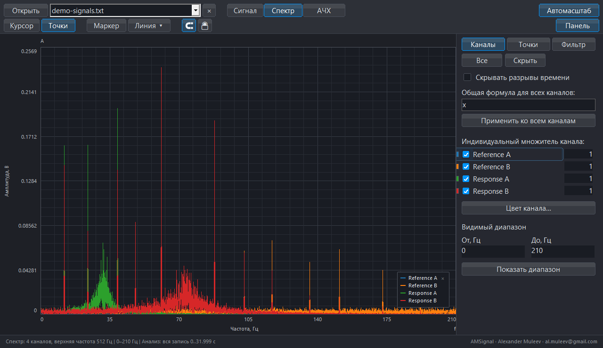
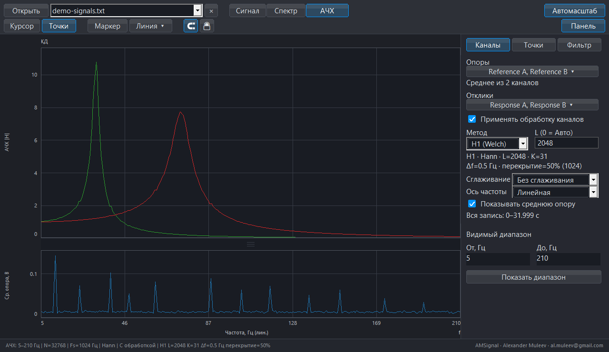
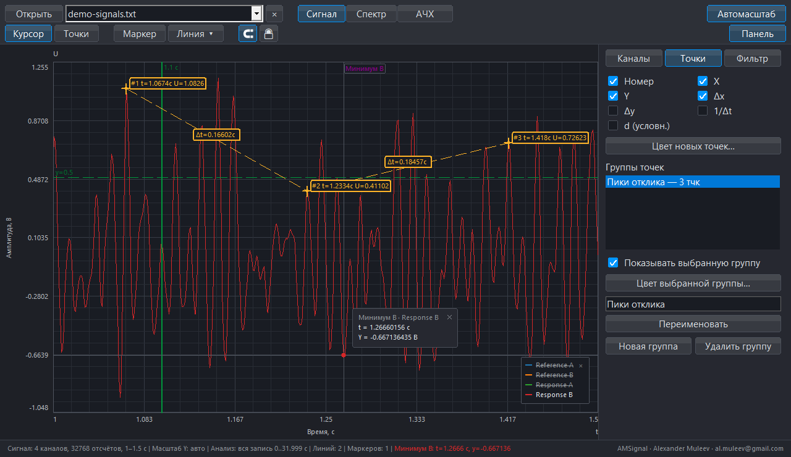
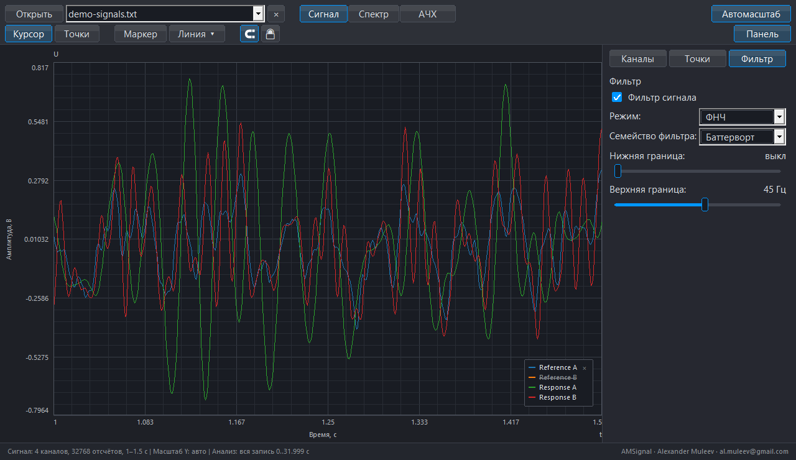
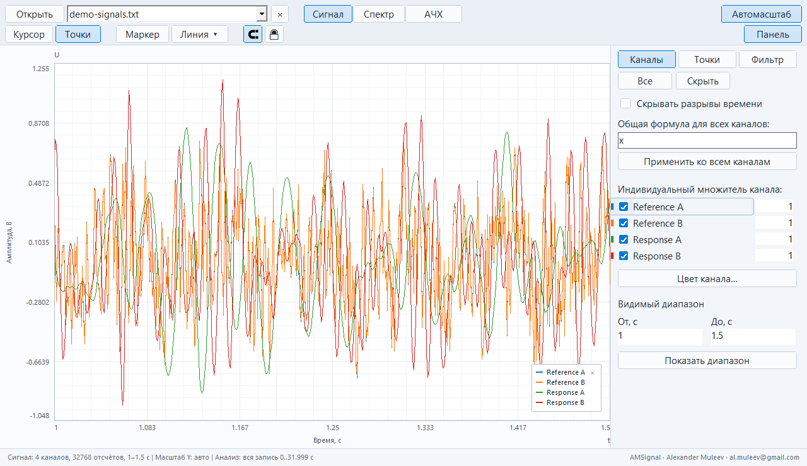

# AMSignal в работе

[Документация](README_RU.md) · [Возможности](FEATURES_RU.md) · [English](GALLERY_EN.md)

Кадры показывают нативный интерфейс локальной рабочей сборки на [синтетической записи с двумя опорами и двумя откликами](../examples/README_RU.md). Они получены кодом отрисовки приложения без курсора и ретуши кривых. Версия, метод и хэши указаны в [описании изображений](assets/screenshots/README.md).

## Сигнал

Четыре канала в диапазоне 1–1,5 с. Расчёт по умолчанию использует всю запись; масштаб просмотра не выбирает вход анализа.

## Спектр

FFT всех 32 768 отсчётов при 1024 Гц; вид 0–210 Гц. Широкополосный фон и 12 тонов показывают частотный состав возбуждения, а два отклика — усиление вблизи резонансов.

## АЧХ с несколькими опорами

Две опоры Reference A / Reference B усредняются перед H1; для Response A / Response B рассчитаны отдельные кривые. Верхний график — КД, нижний — спектр средней опоры. H1/Welch, L=2048, K=31, шаг 0,5 Гц, перекрытие 50%, сглаживание выключено.

## Измерительная разметка

Три точки с координатами и разностью времени, маркер «Минимум B», вертикальная и горизонтальная направляющие. Панель «Точки» показывает группу измерений.

## Фильтр и обработка

Включён ФНЧ Баттерворта с границей 45 Гц. Общая формула и индивидуальные числовые множители находятся отдельно во вкладке «Каналы».

## Светлая тема

Тот же пример в диапазоне 1–1,5 с. Язык и тема меняют оформление без изменения исходных отсчётов.

## Другие возможности

[Страница возможностей](FEATURES_RU.md) дополнительно показывает участок анализа, переименование каналов, множители, общую формулу, фигуры для Ч/Б и настоящий экспорт PNG. [Рецепт примера](../examples/README_RU.md) позволяет повторить расчёт; [описание анализа](ANALYSIS_RU.md) объясняет численные допущения.
