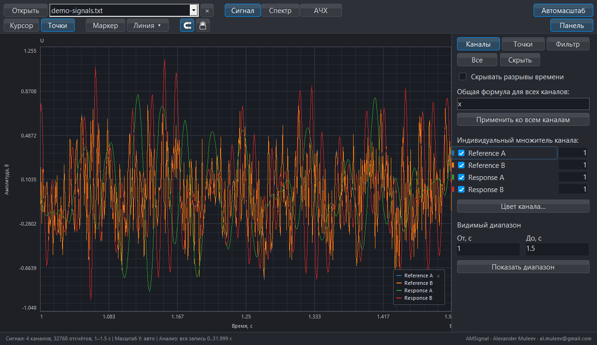

# Руководство пользователя AMSignal

Версия программы: 0.17.5
Язык документа: русский

[Документация](../README_RU.md) · [English](AMSignal_User_Manual_EN.md) · [Быстрый старт](../QUICK_START_RU.md)

## 1. Назначение и основные понятия

AMSignal открывает измерительные записи, показывает временные сигналы, строит амплитудный спектр FFT и оценивает частотную передаточную функцию FRF. Руководство описывает графическое приложение; команды CLI находятся на [странице сборки](../BUILD_RU.md).

**Канал** — ряд значений датчика. **Исходные данные** — отсчёты файла без обработки. **Обработанные данные** — результат общей и индивидуальной формул, затем фильтра. **Участок анализа** — общий временной вход FFT/FRF, независимый от масштаба графика. **Reference** — опора, **Response** — отклик. **КД** — `abs(H)`, линейный модуль передаточной функции.

Программа помогает анализировать эксперимент, но не заменяет проверку датчиков, единиц, синхронности, частоты дискретизации и качества возбуждения. Предупреждение — основание проверить данные, а не подтверждение качества результата.

## 2. Запуск, файлы и документы

Скачайте GUI EXE из [последнего выпуска](https://github.com/almuleev/AMSignal/releases/latest). Архивы Source code предназначены для сборки. На стартовом экране выбираются язык, тема, открытие файла, недавние записи, настройки и справка по клавишам. Пункт **Справка → Начальный экран** позволяет вернуться к сведениям о версии.

Поддерживаются `.lvm`, `.txt`, `.csv` и проекты `.AMSig`. Временной записи нужны временная колонка и хотя бы один числовой канал. Для FRF нужны минимум два синхронных канала. В табличном TXT заголовок `X_Value` подходит для временной оси; формат показан в [демонстрационном файле](../../examples/demo-signals.txt). Единицы в квадратных скобках удаляются из отображаемых имён каналов.

Нажмите **Открыть** или перетащите файлы в окно. Несколько файлов загружаются последовательно, каждый становится отдельным документом. Селектор в верхней панели переключает документы, соседний `×` закрывает активный. Список также доступен через **Файл → Открытые файлы**. У документов независимы данные, разметка, роли FRF, участок и история; поздний результат старого расчёта не применяется к новому документу.

Звёздочка в заголовке означает несохранённые изменения. При закрытии изменённого документа доступны сохранение, закрытие без сохранения и отмена. Сохраняйте активный проект перед переходом к другому варианту обработки.

CSV/TXT с колонкой `Frequency` открывается как готовый спектр. В нём нет временных отсчётов, поэтому недоступны сигнал и расчёт FRF. Экспортированный CSV FRF не открывается как документ FRF.

Приложение записывает `AMS.ini` рядом с EXE, может создавать кэши и регистрирует `.AMSig` для текущего пользователя Windows. Подробности переносимого запуска и подписи — в [политике подписи](../CODE_SIGNING.md).

## 3. Рабочее окно

Верхняя панель содержит открытие и выбор документа, режимы **Сигнал**, **Спектр**, **АЧХ**, инструменты разметки, привязку, блокировку, автомасштабирование и переключатель боковой панели.

В режимах сигнала и спектра справа доступны **Каналы**, **Точки**, **Фильтр**. В FRF — **Каналы** с параметрами расчёта и **Точки**. Нижний блок видимого диапазона находится только в **Каналах**. Строка состояния показывает режим, участок, параметры и предупреждения; при узком окне полный текст доступен при наведении.

На [странице возможностей](../FEATURES_RU.md) и в [галерее](../GALLERY_RU.md) показан нативный интерфейс рабочей сборки с синтетической записью. Это иллюстрация работы интерфейса, а не физический эксперимент.

## 4. Навигация и участок анализа

Колесо меняет масштаб X около указателя. Перетаскивание перемещает вид; короткий щелчок добавляет объект выбранного инструмента, движение от 4 px панорамирует, сохраняя инструмент и Snap. Вертикальное перемещение доступно при включённом вертикальном панорамировании. Меню **Вид** содержит масштабирование, сброс вида, начало/конец, воспроизведение и скорость. Воспроизведение меняет просмотр, а не данные анализа.

**Автомасштабирование** возвращает автоматический Y. В FFT и FRF натуральные амплитудные шкалы начинаются с нуля. Нижний график средней опоры FRF имеет собственную Y-шкалу; разделитель меняет его высоту. Ctrl/Alt с колесом над ним меняют верхний предел, сохраняя нулевую основу.

Внизу **Каналов** задаются границы видимого диапазона: секунды в сигнале, герцы в FFT/FRF. Подтверждение — Enter или **Показать диапазон**. Это настройка представления.

Меню **Анализ** задаёт численный вход:

- **Вся запись** — весь источник независимо от видимого графика.
- **Участок** — явно введённые временные границы.
- **Взять видимый участок** — однократно копирует временной вид.

В сигнале Shift с перетаскиванием выделяет участок; его границы можно перемещать. Границы относятся к исходному времени даже при визуальной склейке. Без выделения используется вся запись. После изменения входа дождитесь нового FFT или запустите FRF заново.

Маркеры разрывов показывают паузы; щелчок открывает сведения о длительности и оценке пропущенных отсчётов. Визуальная склейка сжимает только шкалу и навигацию, сохраняя исходное время в измерениях и экспорте. Она не восстанавливает отсутствующие измерения.

## 5. Каналы

Флажки включают кривые, **Все** и **Нет** меняют видимость всего списка. Имя редактируется двойным щелчком, цвет — через индикатор или выбор цвета канала. Изменения используются в легенде и экспорте, исходные числа сохраняются.

Числовое поле справа задаёт множитель: например, `-1` меняет знак, `0.001` масштабирует в тысячу раз. Enter или уход из поля подтверждают значение. Общее выражение вводите в поле общей формулы на вкладке **Каналы**.

Видимость определяет показываемые кривые и требуемые FFT-каналы. Она не назначает роли FRF: скрытый канал тоже может быть опорой или откликом. Сравнивать разные физические величины по одной вертикальной шкале следует только с учётом их единиц.

## 6. Точки, маркеры, линии и история

Включите **Привязку** для измерения по исходному отсчёту или спектральному бину. Выберите **Точки** и щёлкните по кривой. На вкладке **Точки** создаются, переименовываются, скрываются и удаляются группы, задаются цвета и подписи: номер, X, Y, Δx, Δy, обратная разность координат и расстояние. В сигнале обратная разность — `1/Δt`, в частотном режиме — `1/Δf`; это не автоматическое определение физической причины пика. Евклидово расстояние при разных единицах осей может не иметь физического смысла.

В одной группе нельзя повторить точку с теми же X/Y; разные группы могут совпадать. Удаление последней точки удаляет группу; Undo восстанавливает их вместе.

**Маркер** показывает именованную отметку и значения. Меню **Линия** добавляет вертикальную или горизонтальную направляющую; точный ввод предпочтителен для заданной частоты или уровня. Инструмент остаётся активным для серии отметок. **Курсор** возвращает выбор существующих объектов и их перенос; Snap действует и при переносе.

Выбранный объект удаляется Delete/Backspace. Команды очистки действуют на соответствующий тип разметки текущего режима; сигнал, FFT и FRF имеют отдельные наборы. ПКМ не очищает разметку. Блокировка запрещает изменения разметки, сохраняя навигацию.

Esc отменяет незавершённый жест или инструмент; его действие зависит от состояния, включая карточку разрыва, воспроизведение и участок. Завершённые изменения отменяются через **Файл → Отменить** и возвращаются через **Повторить**. Один перенос или отпускание ползунка — одно действие. История отдельная у каждого документа, ограничена 128 действиями и 64 MiB полезной нагрузки; слишком большое действие может очистить её.

## 7. Формулы и цифровой фильтр

Порядок обработки: общая формула → индивидуальная формула → фильтр. Исходный файл не переписывается. В **Каналах** поле общей формулы и кнопка применения задают выражение для всех каналов; для индивидуальной настройки используйте числовые множители в строках каналов. Формулы, сохранённые в проекте, восстанавливаются вместе с обработкой. На вкладке **Фильтр** находятся цифровые фильтры.

Поддерживаются `x`, числа, скобки, арифметика и функции `abs`, `sqrt`, `sin`, `cos`, `tan`, `log`, `exp`. Примеры: `2.5*x`, `-x`, `x+0.15`, `sqrt(abs(x))`. Проверяйте область определения и единицы: `log(x)` для неположительного аргумента недопустим.

Фильтр предлагает низкочастотный, высокочастотный, полосовой и режекторный режимы. Частоты должны соответствовать доступной частоте Найквиста. Butterworth ориентирован на гладкую амплитудную характеристику, Bessel — фазовое поведение, Chebyshev допускает рябь, Linkwitz–Riley применяется для согласованных разделений полос; влияние выбранного фильтра нужно оценивать для своей методики.

Ползунок применяет значение после отпускания и создаёт одно Undo. Фильтр ослабляет частоты с конечным спадом, а не обнуляет всё за границей. Изменение обработки инвалидирует анализ и может затрагивать разметку; сначала настройте обработку, затем ставьте окончательные точки.

Time/FFT используют активную обработку. FRF имеет явный переключатель обработанных/исходных каналов. Обработка опор выполняется до их усреднения. Для дальнего участка причинному фильтру может потребоваться прогрев от начала источника; кэш продолжений ускоряет его при достаточных ресурсах.

## 8. FFT

1. Определите участок через **Анализ**, проверьте каналы и обработку.
2. Перейдите в **Спектр** и дождитесь фонового расчёта.
3. Задайте частотный вид, изучите пики и поставьте точки.
4. Сохраните PNG либо CSV/TXT спектра.

FFT удаляет среднее и показывает одностороннюю линейную амплитуду. Частотный шаг — `Fs/N`. Короткий участок даёт грубую сетку; длинный может смешать разные физические режимы. Пик не доказывает происхождение колебания.

Неравномерные метки подготавливаются на равномерной сетке с тем же числом отсчётов; большие разрывы сжимаются, сохраняя доступные отсчёты. Интерполяция может ослаблять высокие частоты; NaN заменяются средним канала. Предпочтительна непрерывная равномерная запись. Подробности и ограничения оценки шага — в [описании анализа](../ANALYSIS_RU.md).

Результат кэшируется по источнику, участку, обработке и каналам. Повторный показ готового канала не требует нового FFT; новый канал или вход требуют обновления. Экспорт спектра включает сведения подготовки; LVM для FFT недоступен.

## 9. FRF

1. Откройте синхронную запись возбуждения и отклика, выберите участок.
2. В **АЧХ → Каналы** назначьте непустые непересекающиеся опоры и отклики.
3. Выберите обработанные или исходные каналы, H1 Welch либо Direct и длину `L`.
4. Нажмите **Рассчитать**, проверьте КД, спектр средней опоры и статус coherence.
5. Экспортируйте CSV и PNG; отдельно зафиксируйте настройки опыта.

Меню ролей допускает несколько каналов и остаётся открытым при выборе. Очистка меню снимает только соответствующую роль. Несколько опор усредняются по отсчётам; каждый отклик сравнивается с общей средней опорой. Это не MIMO. Ошибка одного отклика не должна скрывать корректные остальные.

H1 Welch использует периодический Hann и перекрытие 50 %. `L = 0` — Auto; ручное L должно быть чётным, от 4 до N. Большое L улучшает частотную сетку, но уменьшает число сегментов. Неполный хвост не дополняется нулями. При включённом удалении среднего оно выполняется по сегментам.

Direct использует один сегмент всей выбранной последовательности: `L=N`, `K=1`, без перекрытия; в допустимых бинах результат равен отношению комплексных спектров. Это способ сравнения, чувствительный к шуму и нестационарности, а не универсальная замена H1.

FRF использует последовательность отсчётов с Fs по типичному положительному шагу. При разрывах он не вставляет, не удаляет и не интерполирует отсчёты. Welch-сегменты могут пересекать разрывы и секции LVM; предупреждение требует оценки эксперимента. Неконечный вход отклоняется.

КД — `abs(H)`, не dB; единицы — отношение единиц отклика и опоры. Спектр средней опоры имеет отдельную шкалу. DC и слабая опора исключаются, истинный нулевой отклик сохраняется. Coherence имеет отдельную валидность и недоступна для Direct, K<2 и нулевой мощности отклика. Она не исправляет КД автоматически.

Линейная/логарифмическая частота, масштаб, высота нижнего графика и сглаживание от выключенного до 1/3 октавы меняют представление без нового расчёта. Сглаживание не меняет комплексный H и CSV. Фаза не отображается; H2 и MIMO не реализованы.

## 10. Проекты и экспорт

| Задача | Результат |
| --- | --- |
| Сохранить проект | `.AMSig`: исходные отсчёты и восстанавливаемые настройки |
| Сохранить обработанные каналы | Формулы и фильтр применяются к данным |
| Сохранить исходные каналы | Все исходные каналы без обработки и разметки |
| Сохранить PNG | Текущий график с видимыми кривыми, оформлением и разметкой |

**Сохранить проект** использует Ctrl+S. **Сохранить как** (Ctrl+Shift+S) предлагает назначение, формат, диапазон и состав данных. Для проекта формат фиксирован; для канальных результатов выбираются допустимые CSV/TXT/LVM. Сигнал поддерживает все три, спектр — CSV/TXT, FRF — CSV. PNG сохраняется отдельно через Ctrl+Alt+S.

Для сигнала различайте выбранный, видимый и полный диапазоны. Для спектра диапазон частотный. Обработанный экспорт может включать скрытые каналы, имена, формулы, фильтр и метаданные разметки/графика; исходный экспорт сохраняет исходные каналы без этих настроек.

Проект сохраняет имена, видимость, обработку, разметку, участок и поддерживаемые параметры представления. Он не заменяет протокол эксперимента: роли FRF, метод, L и фактический результат дополнительно сохраняйте в CSV и описании опыта. Ошибка записи не должна считать проект сохранённым или заменять прежний файл частичным.

FRF CSV содержит частоту, КД, действительную/мнимую части H, valid, coherence/coherence_valid, спектр опоры и идентификаторы откликов. Метаданные включают параметры расчёта; точные столбцы сверяйте с файлом вашей версии. Такой CSV не содержит временных отсчётов для повторного расчёта.

PNG использует общую отрисовку графика и подпись Generated by AMSignal. Перед публикацией проверьте единицы, легенду, диапазон и случайные объекты. Для чёрно-белой печати доступны фигуры кривых. Сглаживание временных кривых и фигуры — оформление, не цифровая обработка.

## 11. Большие записи и ресурсы

Источник автоматически открывается целиком в RAM либо через полный дисковый обзор. Отдельного Light Mode и обязательного ручного выбора фрагмента при обычном открытии нет. Min/max-обзор служит отрисовке; точный Snap и анализ используют исходные отсчёты.

Бюджет **Данные + расчёты** — Auto либо 64–65536 MiB с учётом доступной памяти и системного резерва. Это не предел всей памяти процесса. RAM/private commit процесса, квота кэша записей и временные файлы расчёта — разные величины.

FFT может использовать временный диск, сохраняя N и частотную сетку. Нужны свободное место и время; ошибки ресурсов или ввода-вывода могут остановить расчёт. Изменение файла-источника во время работы требует его повторного открытия. Не удаляйте используемые исходники и рабочие файлы.

Текущая область испытаний — до **10 000 000 000 байт включительно**. Это не программный предел открытия и не гарантия любого анализа на любом компьютере. Старые замеры относятся к своим версиям и условиям. Подробности — [анализ и ограничения](../ANALYSIS_RU.md).

## 12. Настройки и горячие клавиши

**Настройки → Общие настройки** содержит язык, тему, подписи осей, маркеры разрывов и ресурсы. Настройки записываются в AMS.ini. Тема и язык не меняют числа; подписи должны включать физические единицы. Глобальный показ разрывов действует на все документы и не является частью проекта.

**Справка → Горячие клавиши** показывает действующие назначения. Их можно изменить, очистить или сбросить; конфликтующие сочетания требуют исправления. В текстовом поле обычные клавиши вводят текст, а не переключают режим.

| Действие | По умолчанию |
| --- | --- |
| Открыть | Ctrl+O |
| Проект / Сохранить как / PNG | Ctrl+S / Ctrl+Shift+S / Ctrl+Alt+S |
| Отменить / Повторить | Ctrl+Z / Ctrl+Shift+Z |
| Сигнал / Спектр / FRF | S / F / R |
| Курсор / Точки / Привязка / Блокировка | N / P / G / L |
| Маркер / Вертикальная / Горизонтальная линия | M / V / H |
| Точная линия | Shift+L |
| Каналы / Точки / Фильтр | Ctrl+1 / Ctrl+2 / Ctrl+3 |
| Панель / Автомасштабирование | B / A |
| Участок / Видимый участок / Вся запись | Ctrl+I / Ctrl+Shift+I / Ctrl+Alt+I |
| Фильтр / Склейка разрывов | Shift+F / Shift+G |
| Тема / Воспроизведение | D / Пробел |
| Сброс / Начало / Конец | Home / Ctrl+Home / Ctrl+End |
| Справка по клавишам | F1 |

## 13. Решение проблем

| Симптом | Что проверить |
| --- | --- |
| Файл не открывается | Формат, доступность, числовые строки, предупреждения парсера; для FRF CSV нужен исходный сигнал |
| FFT не готов или выглядит неожиданно | Завершение задания, участок, видимость, обработку, единицы, разрывы и стационарность |
| FRF недоступна | Временные отсчёты, непустые непересекающиеся роли, допустимое L и конечные значения |
| КД шумный или coherence низкая | Амплитуду опоры, синхронность, шум, участок и число усреднений; не скрывайте проблему одним сглаживанием |
| Coherence недоступна | Direct, K<2, слабая опора, нулевая мощность отклика или недопустимый бин |
| Большая запись работает медленно | Свободное место, RAM/commit, дисковый путь и прогрев фильтра; уменьшайте участок осознанно |
| Источник изменился или результат устарел | Сохраните нужную работу, заново откройте источник и повторите расчёт |
| Сохранение не удалось | Путь, доступ, свободное место; документ не следует считать сохранённым |

К сообщению об ошибке приложите версию, Windows, шаги, параметры, полный статус и небольшой пример без конфиденциальных данных. Для уязвимостей используйте [закрытый канал](../../.github/SECURITY.md).

## 14. Методика и воспроизводимость

Обозначения: N — число отсчётов, Fs — частота дискретизации, L — длина сегмента, K — число сегментов. Для FFT `f[k]=k*Fs/N`, для H1 `df=Fs/L`.

`X[k]=sum(x[n]*exp(-j*2*pi*k*n/N))`. После удаления среднего односторонняя амплитуда внутренних бинов — `2*abs(X)/N`, DC и Найквиста — `abs(X)/N` с соответствующей обработкой нечётного N.

Для сегментных спектров H1: `Sxx=sum(abs(Xm)^2)`, `Syy=sum(abs(Ym)^2)`, `Sxy=sum(conj(Xm)*Ym)`; `H1=Sxy/Sxx`, `КД=abs(H1)`. Спектральные накопления выполняются до отношения; усреднение готовых FRF блоков не эквивалентно H1.

`coherence=abs(Sxy)^2/(Sxx*Syy)` в допустимых бинах. Она лежит в 0…1, но близость к 1 не исключает систематической ошибки. Слабая опора маскируется по относительной мощности порядка `max(Sxx)*10^-12` с численной защитой; это технический порог, не физический критерий качества опыта.

Линейная амплитуда средней опоры для внутренних бинов H1: `Aref=2*sqrt(mean(abs(Xm)^2))/sum(Hann)`; крайние бины имеют соответствующую одностороннюю нормировку. Не подменяйте этой шкалой КД. Одинаковый линейный фильтр входа и выхода может сократиться в отношении, поэтому спектр опоры проверяется отдельно.

Сохраняйте исходный файл, проект, фактическую версию, единицы, участок, роли, формулы, фильтр, метод, N/L/K, частотный вид, сглаживание и предупреждения. Для статьи укажите эти параметры в методике и подписи рисунка. Не выводите причину резонанса только по форме КД и не считайте результаты разных входов/обработок эквивалентными без обоснования.

## 15. Практические сценарии и материалы

- **Проверка новой записи:** откройте файл, изучите каналы, единицы и разрывы; сохраните проект до обработки.
- **Поиск частоты:** выберите установившийся участок, рассчитайте FFT, измерьте пик, сохраните CSV и PNG.
- **Сопоставление откликов:** назначьте общую опору и несколько откликов, рассчитайте H1, проверьте возбуждение и coherence.
- **Подготовка рисунка:** задайте понятные оси и легенду, удалите лишнюю разметку, проверьте PNG и сохраните параметры вместе с CSV.

[Пример](../../examples/README_RU.md) · [Галерея](../GALLERY_RU.md) · [Анализ и ограничения](../ANALYSIS_RU.md) · [Сборка и CLI](../BUILD_RU.md)

Прежняя расширенная редакция и старый DOCX относятся к истории; текущие языковые версии перечислены на [странице руководств](README.md).
